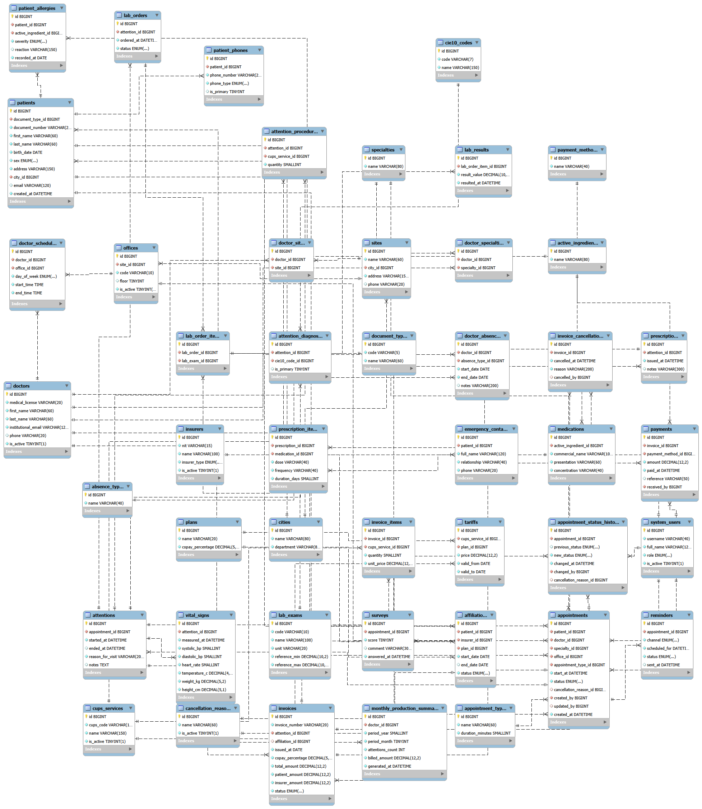

# MediCita IPS · Base de datos

**Autor:** Jose Miguel Sandoval
**Motor:** MySQL 8.4 · **Base:** `medicita_ips` · **Fecha de corte de los datos:** 2026-11-30

## 1. Descripción del proyecto

MediCita IPS es una institución prestadora de servicios de salud con cuatro sedes en el área metropolitana de Bucaramanga: Cabecera, Cañaveral, Girón Centro y Piedecuesta. Hoy la agenda, las atenciones y la facturación viven en hojas de cálculo y documentos de Word.

En octubre de 2026 pasaron tres problemas:

1. Dos pacientes quedaron agendados a la misma hora con el mismo médico.
2. A una paciente se le formuló un medicamento al que es alérgica.
3. La cartera con una aseguradora no cuadró por más de 3 millones.

En este proyecto construí la base de datos del nuevo sistema. Incluye el modelo, la estructura, datos de prueba, consultas, funciones, procedimientos, triggers, eventos y permisos por rol. Mi objetivo fue que esos tres problemas quedaran controlados por la propia base de datos y no dependieran de que alguien revise a mano.

## 2. Cómo ejecutarlo

Requisitos: MySQL Server 8 y el reloj de eventos encendido (`SET GLOBAL event_scheduler = ON;`).

Desde la terminal (PowerShell), en la carpeta del proyecto, entra a MySQL como root:

```
mysql -u root -p --default-character-set=utf8mb4
```

Dentro de `mysql>`, ejecuta los scripts en este orden:

```
SOURCE sql/01_ddl.sql;
SOURCE sql/02_dml.sql;
SOURCE sql/03_dql.sql;
SOURCE sql/04_funciones.sql;
SOURCE sql/05_procedimientos.sql;
SOURCE sql/06_triggers.sql;
SOURCE sql/07_eventos.sql;
SOURCE sql/08_dcl.sql;
```

- `01_ddl.sql` empieza con `DROP DATABASE IF EXISTS medicita_ips;`, así que se puede repetir las veces que sea necesario.
- Las sentencias que deben fallar a propósito están marcadas con `-- ⚠️ ESPERADO: ERROR <código>`. `SOURCE` muestra el error y sigue con la siguiente sentencia. En total son 35: 4 en el DML, 1 en funciones, 14 en procedimientos, 12 en triggers y 4 en DCL.
- El orden importa: los procedimientos usan las funciones, T-3 se prueba con `sp_cancelar_cita` y el DCL da permisos sobre rutinas que ya deben existir.
- `07_eventos.sql` tarda unos 20 segundos, porque espera con `SELECT SLEEP(4);` a que corra cada evento.

## 3. Reglas corroboradas

Antes de diseñar, comparé cada regla del análisis preliminar con lo que dijeron los tres entrevistados: Dra. Marcela Ortiz (directora médica), Hernán Rueda (agendamiento) y Liliana Prada (facturación).

| Regla | ¿Se confirma? | Evidencia (quién lo dijo) | Corrección |
| --- | --- | --- | --- |
| RP-01: Un paciente se identifica por tipo y número de documento; el número no se repite dentro del mismo tipo. | Sí | Hernán Rueda: "Un mismo número puede existir con dos tipos distintos, pero no se repite dentro del mismo tipo." | Ninguna. Se protege con `UNIQUE (document_type_id, document_number)`. |
| RP-02: Cada paciente tiene un único número de teléfono. | No | Hernán Rueda: "Los pacientes tienen varios teléfonos, y uno es el principal para llamarlos." | Un paciente tiene uno o varios teléfonos y exactamente uno es el principal. |
| RP-03: Cada médico pertenece a una sola especialidad. | No | Dra. Ortiz: "La doctora Salazar es internista y también cardióloga, y atiende citas de las dos." | Un médico puede tener una o varias especialidades (relación N:M). |
| RP-04: Un médico puede atender en varias sedes. | Sí | Dra. Ortiz: "Un mismo médico atiende en varias sedes, y eso no depende de la especialidad." | Se agrega que sedes y especialidades son hechos independientes (ver 4FN). |
| RP-05: La duración de una cita depende del tipo de cita. | Sí | Hernán Rueda: "Se escoge el tipo de cita… que define cuánto dura: 20, 30 o 40 minutos." | Ninguna. |
| RP-06: Un médico no puede tener dos citas que se crucen en el tiempo. | Sí, incompleta | Hernán Rueda: "Un médico no puede tener dos citas que se crucen, y un consultorio tampoco." | Tampoco un consultorio puede tener dos citas cruzadas. Las citas canceladas no cuentan para el cruce. |
| RP-07: No se puede agendar fuera del horario del médico ni durante sus novedades. | Sí | Dra. Ortiz: "Cada médico tiene un horario semanal… En esas fechas no se le puede agendar nada." | Ninguna. La novedad tiene fecha de inicio y de fin. |
| RP-08: Una cita se puede cancelar sin indicar el motivo. | No | Hernán Rueda: "Toda cancelación lleva un motivo de nuestra lista… Sin motivo no se cancela." | El motivo es obligatorio y debe existir en el catálogo de motivos. |
| RP-09: Cada cambio de estado de una cita queda en un historial. | Sí | Hernán Rueda: "Necesito saber cada cambio de estado: de cuál a cuál pasó, cuándo y quién lo hizo." | Se precisa qué se guarda: estado anterior, estado nuevo, fecha y responsable. |
| RP-10: Un paciente puede tener varias afiliaciones vigentes al mismo tiempo. | No | Hernán Rueda: "Guardamos el historial, pero solo puede haber una afiliación vigente. Si no tiene ninguna vigente, se atiende como particular." | Puede tener varias afiliaciones en el historial, pero solo una vigente. Sin afiliación vigente, se atiende como PARTICULAR. |
| RP-11: Una atención registra uno o varios diagnósticos, y uno de ellos es el principal. | Sí | Dra. Ortiz: "Uno o varios diagnósticos con el código CIE-10 y uno de ellos marcado como principal." | Se agrega que un mismo diagnóstico no se repite en la misma atención. |
| RP-12: No se formula un medicamento cuyo principio activo cause alergia al paciente. | Sí | Dra. Ortiz: "Las alergias del paciente se registran contra el principio activo… no contra la marca." | Ninguna. La alergia se guarda contra el principio activo. |
| RP-13: El precio de un servicio es el mismo para todos los pacientes. | No | Liliana Prada: "El precio no es el mismo para todos: depende del plan del paciente… las tarifas cambian." | El precio depende del servicio, del plan y de la fecha. Se usa la tarifa vigente el día de la atención. |
| RP-14: Si hay un error en una factura, se borra y se vuelve a hacer. | No | Liliana Prada: "Las facturas nunca se borran: si hay un error se anulan." | La factura nunca se borra; se anula con fecha y motivo. |
| RP-15: Una factura queda PAGADA cuando sus abonos completan el total. | Sí, incompleta | Liliana Prada: "PAGADA cuando los abonos completan el total." | Faltan los demás estados: PENDIENTE, PARCIAL (tiene abonos), VENCIDA (30 días sin pago completo) y ANULADA. |

### Reglas que faltaban

| Regla | Evidencia (quién lo dijo) |
| --- | --- |
| RP-16: La cita es en una especialidad que el médico tenga, en un consultorio de una sede donde el médico atienda y dentro de su horario. | Hernán Rueda |
| RP-17: La cita nace PROGRAMADA y pasa a CONFIRMADA, ATENDIDA, CANCELADA o NO_ASISTIO. | Hernán Rueda |
| RP-18: Los signos vitales fuera de rangos posibles se rechazan. | Dra. Ortiz |
| RP-19: Una fórmula tiene uno o varios medicamentos, cada uno con dosis, frecuencia y número de días. | Dra. Ortiz |
| RP-20: Cada examen tiene unidad y rango de referencia; se debe saber si el resultado quedó fuera del rango. | Dra. Ortiz |
| RP-21: El paciente tiene uno o más contactos de emergencia. | Hernán Rueda |
| RP-22: El día anterior a cada cita se envía un recordatorio (SMS, correo o WhatsApp) y se guarda si se envió o falló. | Hernán Rueda |
| RP-23: La encuesta de satisfacción va de 1 a 5, con comentario opcional, solo para citas atendidas y una sola vez por cita. | Hernán Rueda |
| RP-24: Cada atención genera una sola factura; cada renglón copia el precio del día y no cambia si la tarifa cambia después. | Liliana Prada |
| RP-25: Cada plan tiene un porcentaje de copago que paga el paciente; el resto se cobra a la aseguradora. El particular paga el 100 %. | Liliana Prada |
| RP-26: Una factura se puede pagar en varios abonos, con distintos medios de pago; cada abono es mayor que 0. | Liliana Prada |
| RP-27: Una factura sin pagar completa 30 días después de su emisión pasa a VENCIDA. | Liliana Prada |
| RP-28: A fin de mes el sistema arma solo un resumen de producción por médico (atenciones y valor facturado). | Liliana Prada |

## 4. Normalización

### 1FN · Atributos multivaluados

Hernán Rueda dijo que "los pacientes tienen varios teléfonos". Si guardáramos los teléfonos en una sola columna de `patients` (por ejemplo `'3001234567, 6076543210'`), la columna tendría varios valores y no se podría marcar cuál es el principal. Por eso los teléfonos van en su propia tabla `patient_phones`, con una fila por teléfono y una columna `is_primary`. Lo mismo pasa con los contactos de emergencia (`emergency_contacts`) y con los diagnósticos de una atención (`attention_diagnoses`).

### 2FN · Dependencia parcial de una clave compuesta

En la tabla de diagnósticos de una atención, la clave natural es `(attention_id, cie10_code_id)`, porque un diagnóstico no se repite en la misma atención. Si en esa tabla guardáramos también el nombre del diagnóstico (`'Hipertensión esencial'`), ese nombre dependería solo de `cie10_code_id` y no de la clave completa. Esa es una dependencia parcial. El nombre se movió a la tabla catálogo `cie10_codes`, y `attention_diagnoses` solo guarda la referencia y si es el diagnóstico principal.

### 3FN · Dependencia transitiva

Si la tabla `appointments` guardara el tipo de cita y también su duración en minutos, tendríamos `cita → tipo de cita → duración`. La duración no depende de la cita sino del tipo, como dijo Hernán Rueda: "el tipo de cita… define cuánto dura". Esa es una dependencia transitiva. Se eliminó creando `appointment_types` con su `duration_minutes`, y la cita solo guarda `appointment_type_id`.

### 4FN · Especialidades y sedes de un médico

La Dra. Ortiz explicó que el doctor Pabón es pediatra y dermatólogo y atiende en Cabecera y en Girón, y que "puede atender cualquiera de las dos especialidades en cualquiera de las dos sedes". Si usáramos una sola tabla `(médico, especialidad, sede)`, tendríamos que guardar todas las combinaciones:

| doctor | specialty | site |
| --- | --- | --- |
| Pabón | Pediatría | Cabecera |
| Pabón | Pediatría | Girón Centro |
| Pabón | Dermatología | Cabecera |
| Pabón | Dermatología | Girón Centro |

Hay dos dependencias multivaluadas independientes: médico →→ especialidad y médico →→ sede. Eso viola la 4FN y provoca anomalías. Si Pabón empieza a atender en Piedecuesta, hay que insertar dos filas, una por especialidad. Si se olvida una, la tabla diría que no puede atender dermatología allí, y eso es falso.

La solución fue descomponer en dos tablas independientes:

- `doctor_specialties (doctor_id, specialty_id)`
- `doctor_sites (doctor_id, site_id)`

Ahora agregar una sede es una sola fila, y la combinación válida se obtiene con un JOIN.

## 5. Diagramas

### 5.1 Diagrama entidad-relación hecho a mano


### 5.2 Diagrama lógico por ingeniería inversa

Se generó con **MySQL Workbench 8.0 → Database → Reverse Engineer** después de ejecutar `01_ddl.sql`. Tiene las 46 tablas y sus 58 llaves foráneas, y coincide con el DDL y con el diagrama a mano.



## 6. Reglas que no protege la estructura y dónde se resolvieron

Un `CHECK` solo ve **una fila**. Las reglas que comparan varias filas o varias tablas se resolvieron así:

| Regla | Objeto |
|---|---|
| Un médico no tiene dos citas que se crucen (RP-06) | `fn_medico_disponible` + `sp_agendar_cita` |
| Un consultorio no tiene dos citas que se crucen | `sp_agendar_cita` (validación 4) |
| No se agenda fuera del horario ni durante novedades (RP-07) | `fn_medico_disponible` |
| La cita es con una especialidad del médico y en una sede donde atiende | `sp_agendar_cita` (validaciones 1 y 2) |
| Solo una afiliación ACTIVA por paciente (RP-10) | `trg_affiliations_before_insert` / `_before_update` |
| La cancelación lleva un motivo del catálogo (RP-08) | `CHECK` en `appointments` + `sp_cancelar_cita` |
| Cada cambio de estado queda en el historial (RP-09) | `trg_appointments_after_update` (T-3) |
| No se formula un principio activo al que el paciente es alérgico (RP-12) | `trg_prescription_items_before_insert` (T-5) |
| El precio es el de la tarifa vigente el día de la atención (RP-13) | `fn_tarifa_vigente` + `sp_facturar_atencion` |
| Las vigencias de una tarifa no se cruzan | `trg_tariffs_before_insert` |
| La factura no se borra, se anula (RP-14) | `trg_invoices_before_delete` (T-2) + `sp_anular_factura` |
| PARCIAL o PAGADA según los abonos (RP-15) | `trg_payments_after_insert` (T-4) |
| No se abona a una factura anulada o pagada, ni por más del saldo | `trg_payments_before_insert` |
| VENCIDA a los 30 días sin pagar completa | `evt_marcar_facturas_vencidas_diario` (E-4) |
| Solo se encuestan citas ATENDIDA | `trg_surveys_before_insert` |
| Los signos vitales tienen rangos posibles | `CHECK` en el DDL + T-1 (mensaje en español) |

> Nota sobre el nombre de un trigger: el enunciado los nombra con la tabla, y las tablas del DDL se llaman igual (`vital_signs`, `invoices`, `appointments`, `payments`, `prescription_items`), así que **ningún nombre de trigger cambió**. La tabla de encuestas se llama `surveys`, por eso su trigger de apoyo es `trg_surveys_before_insert`.

## 7. Características de cada función

| Función | Características | Por qué |
|---|---|---|
| `fn_edad` | `DETERMINISTIC`, `NO SQL` | Solo calcula con las dos fechas que recibe; las mismas fechas siempre dan la misma edad |
| `fn_imc` | `DETERMINISTIC`, `NO SQL` | Es una fórmula sobre sus parámetros; no lee tablas |
| `fn_tarifa_vigente` | `NOT DETERMINISTIC`, `READS SQL DATA` | Lee `tariffs`; si alguien cambia una tarifa, la misma entrada da otro precio |
| `fn_saldo_factura` | `NOT DETERMINISTIC`, `READS SQL DATA` | Lee `invoices` y `payments`; el saldo cambia con cada abono |
| `fn_medico_disponible` | `NOT DETERMINISTIC`, `READS SQL DATA` | Lee horarios, novedades y citas; cambia cada vez que se agenda o cancela |

Si no se declaran, MySQL responde **ERROR 1418** porque el binary log está activo.

## 8. Roles y permisos

| Rol | Puede | No puede (evidencia en 08_dcl.sql) |
|---|---|---|
| `rol_recepcion` | `SELECT` de pacientes, médicos, agenda y catálogos; `EXECUTE` de `sp_registrar_paciente`, `sp_agendar_cita`, `sp_cancelar_cita` | `UPDATE appointments` → **1142**; ver diagnósticos o facturas → **1142**; `CALL sp_facturar_atencion` → **1370** |
| `rol_medico` | `SELECT` de pacientes, agenda y tablas clínicas; `INSERT` de atenciones, signos, diagnósticos, fórmulas y laboratorio; `UPDATE (status)` de la cita | Ver facturas → **1142**; `DELETE` de datos clínicos → **1142** |
| `rol_facturacion` | `SELECT` de atenciones, tarifas y facturación; `INSERT` de abonos; `EXECUTE` de `sp_facturar_atencion`, `sp_anular_factura`, `sp_reporte_produccion` | `UPDATE invoices` → **1142**; `DELETE invoices` → **1142**; ver fórmulas → **1142**; agendar → **1370** |
| `rol_auditor` | `SELECT` de todas las tablas; en `patients` solo por columnas (sin documento, dirección ni correo) | `SELECT document_number` → **1143**; teléfonos → **1142**; `UPDATE` → **1142** |
| `rol_admin_bd` | `ALL PRIVILEGES ON medicita_ips.*` | Leer `mysql.user` → **1142**; crear otra base → **1044** |

**Por qué funciona "solo con los procedimientos":** los procedimientos son `SQL SECURITY DEFINER` (el valor por defecto) y corren con los permisos de root, que fue quien los creó. Recepción tiene `EXECUTE` sobre `sp_agendar_cita`, pero no `INSERT` sobre `appointments`: puede agendar, y solo de la forma controlada.

## 9. Evidencias

### Consultas


### Procedimiento

`CALL sp_reporte_produccion('2026-11-01', '2026-11-30');`


### Trigger

T-5 rechaza formular ibuprofeno a un paciente alérgico (ERROR 1644) y deja pasar un medicamento seguro.


### Evento

E-1 pasa a NO_ASISTIO las citas que empezaron antes del corte y deja su historial.


## 10. Cómo trabajé el proyecto

Desarrollé el proyecto en Visual Studio Code, con MySQL 8.4 en Windows. Este fue el proceso y los problemas que tuve que resolver:

| Etapa | Qué hice | Problema y cómo lo resolví |
| --- | --- | --- |
| Análisis | Leí el enunciado y comparé las 15 reglas con las entrevistas. | Encontré 6 reglas mal entendidas y 13 que faltaban (sección 3). |
| Entorno | Instalé MySQL 8.4, configuré VS Code y creé el repositorio. | `mysql` no se reconocía en PowerShell. Agregué `C:\Program Files\MySQL\MySQL Server 8.4\bin` al PATH. |
| Modelo | Empecé el modelo en DrawSQL. | Al importar el script solo entraron unas 25 de las 46 tablas y sin llaves foráneas, por el límite del plan gratuito. Decidí usar DrawSQL solo como borrador. |
| Diagrama lógico | Ejecuté `01_ddl.sql` y generé el diagrama por ingeniería inversa. | El Workbench nuevo (26.10) ya no trae *Reverse Engineer*. Instalé Workbench 8.0.47 y desde ahí lo generé. |
| Ejecución | Corrí los scripts desde la terminal. | En PowerShell no funciona `mysql < archivo.sql`, y con `-e "source …"` el script se detiene en el primer error esperado. Por eso los ejecuto con `SOURCE` dentro de `mysql>`. |
| Pruebas | Cargué los scripts 04 a 08. | La primera vez respondieron `Query OK, 0 rows affected` al instante: los archivos seguían vacíos. Los completé, los volví a ejecutar y verifiqué los errores esperados. |
| Evidencias | Tomé las capturas de la sección 9. | — |

### Uso de inteligencia artificial

Usé un asistente de IA (Claude) como tutor durante el proyecto. Me explicó cada fase paso a paso, me propuso borradores del código SQL y de este README y me ayudó a resolver los errores de instalación. Yo instalé y configuré las herramientas, tomé las decisiones de qué usar cuando algo no funcionó, ejecuté y probé cada script en mi equipo y revisé los resultados.

### Qué aprendí

Como desarrollar el modelo E - R, la estructura de una base de datos. a realizar creacion de tablas desde visual studio, tambien a crear las tablas en DrawSql, a realikzar consultas, funciones, restricciones y a organizarla de forma correcta y cohereente tambien cada ves mas estoy a prendiendo como usar la AI a mi favor para desarrolar este tipo de proyectos.

## 11. Conclusiones

- Corroborar las reglas contra las entrevistas antes de diseñar cambió mi modelo. Seis de las quince reglas preliminares estaban mal entendidas; si las hubiera modelado tal cual, la base habría repetido los errores de octubre.
- Comprobé que la estructura (PK, FK, UNIQUE, CHECK y ENUM) solo protege las reglas de una fila. Las que comparan varias filas, como el cruce de citas, la alergia o la tarifa del día, necesitaron funciones, procedimientos y triggers.
- Los tres problemas de octubre quedaron controlados por la base: `sp_agendar_cita` impide citas cruzadas, T-5 bloquea medicamentos a los que el paciente es alérgico, y la cartera cuadra porque el precio se copia en la factura y los estados los ponen T-4 y E-4.
- Con roles y procedimientos `SQL SECURITY DEFINER`, cada área solo puede hacer lo que le corresponde y de la forma controlada.
